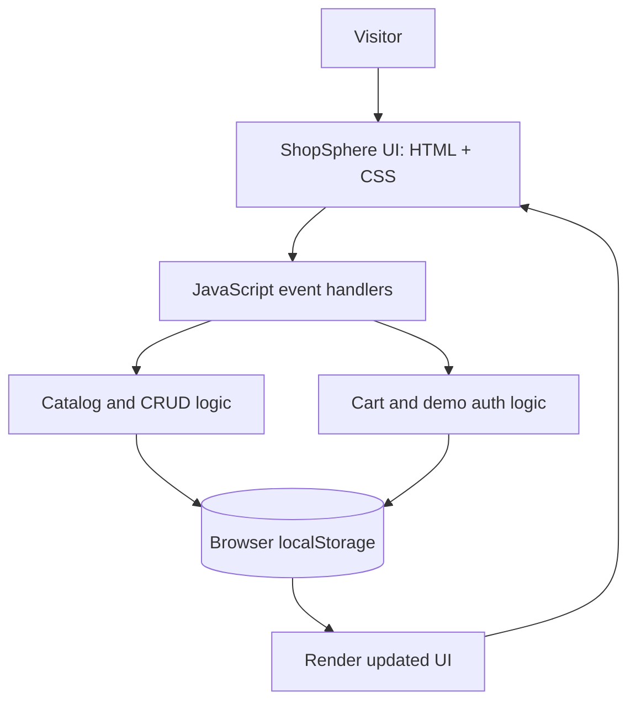

# ShopSphere — E-Commerce Capstone

A responsive, frontend-only e-commerce storefront built with semantic HTML5, modern CSS, and vanilla JavaScript. This project demonstrates catalog filtering, simulated authentication, shopping-cart operations, CRUD product management, and browser persistence.

## Features

- Responsive storefront layout for desktop, tablet, and mobile
- Product catalog with search, category filters, and sorting
- Shopping cart: add, remove, change quantities, and calculate subtotal
- Demo registration, sign-in, and sign-out
- Admin-style product management: create, read, update, and delete
- `localStorage` persistence for products, cart, and demo session
- Accessible labels, semantic landmarks, keyboard focus indicators, and live status messages
- Newsletter form interaction and demo checkout flow
- No build step or API key required

## Technology stack

- HTML5
- CSS3 (custom properties, Grid, Flexbox, responsive media queries)
- Vanilla JavaScript (ES6+, DOM APIs, event delegation)
- Browser `localStorage`
- Git and GitHub
- Vercel deployment

## Project structure

```text
shopsphere-capstone/
├── index.html
├── style.css
├── script.js
└── README.md
```

## Architecture



The browser renders the UI. JavaScript handles user actions and updates application state. `localStorage` persists demo products, cart contents, registered demo users, and the session on the current browser.

## Run locally

1. Download or clone the repository.
2. Open the folder in Visual Studio Code.
3. Open `index.html` directly in a browser, or use the **Live Server** extension.
4. No package installation or build command is needed.

## Test checklist

- Search for a product by name
- Filter by category and change the sort order
- Add an item to the bag, change quantity, remove it, and reload the page
- Create a demo account, sign out, and sign in again
- Add a product in the admin workspace, edit it, then delete it
- Resize the browser to check mobile and desktop layouts
- Verify the deployed website in a private/incognito window

## Deploy to Vercel

1. Push this project to a GitHub repository.
2. Sign in to [Vercel](https://vercel.com/) using GitHub.
3. Select **Add New → Project** and import the ShopSphere repository.
4. For a static site, leave the framework preset as **Other** (or no framework).
5. Leave build command and output directory blank if Vercel permits; there is no build step.
6. Click **Deploy** and wait for the deployment to finish.
7. Open the generated public URL and test the main features.

## Important demo limitations

- Authentication is simulated in the browser. Demo passwords are stored in `localStorage`, which is not secure. Do not use real passwords or personal information.
- Product management is browser-local, not a shared database. Changes are specific to the browser and device.
- Checkout is a simulation; no payment is collected and no real order is created.
- The newsletter form does not send email to a mailing service.
- Product photography is loaded from external image URLs and requires an internet connection.

## Capstone deliverables

- GitHub source repository: _add your repository URL here_
- Live deployment: _add your Vercel URL here_
- Screenshots: _add screenshots to a `screenshots/` folder and link them here if required_

## License

Created as an educational internship capstone project.
